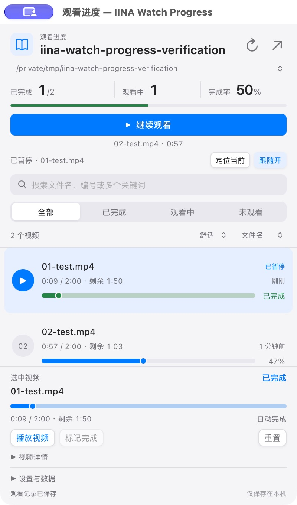
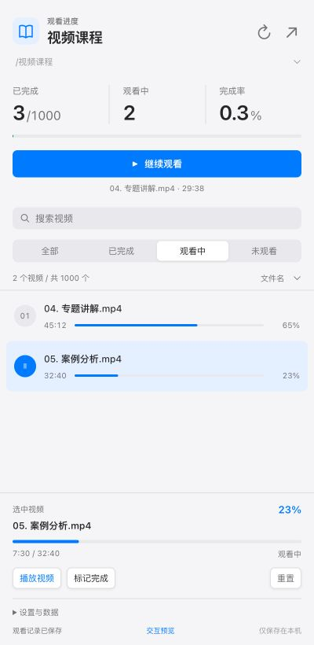
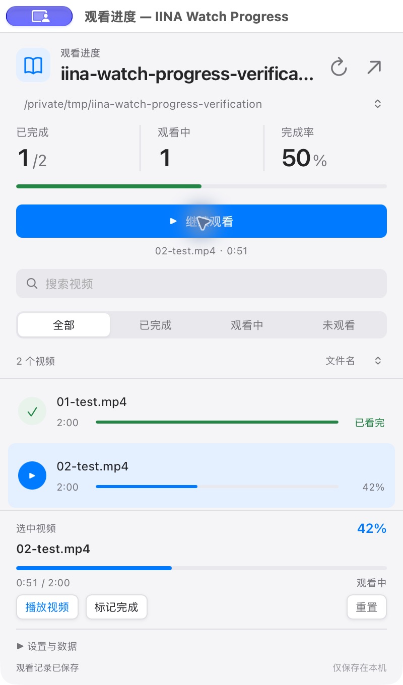
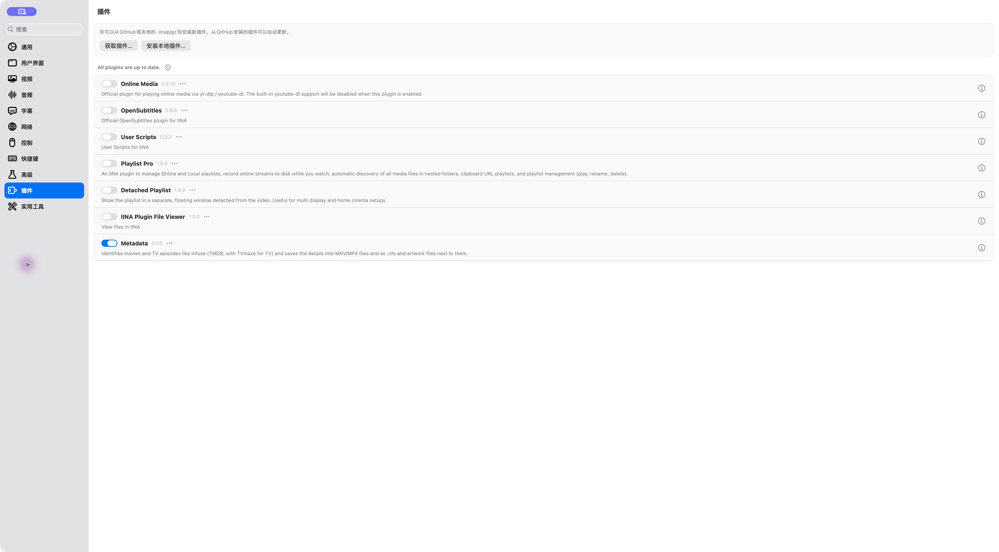
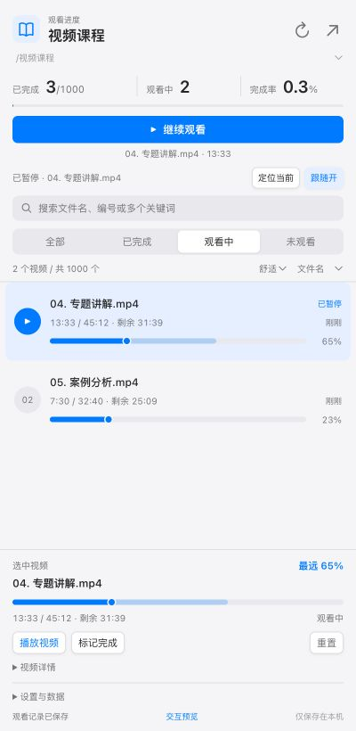
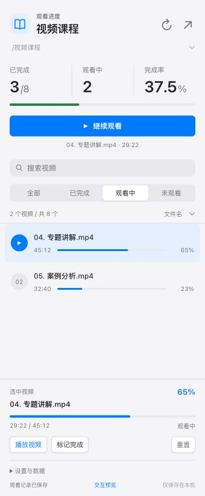
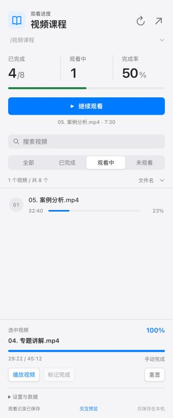
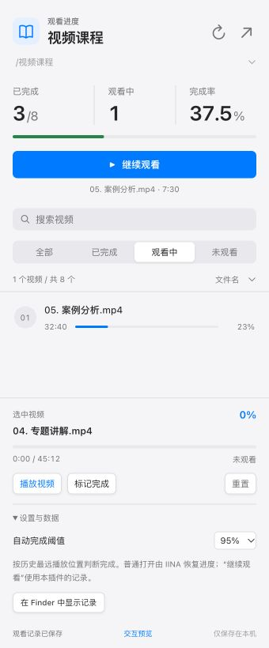
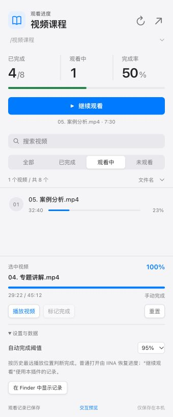
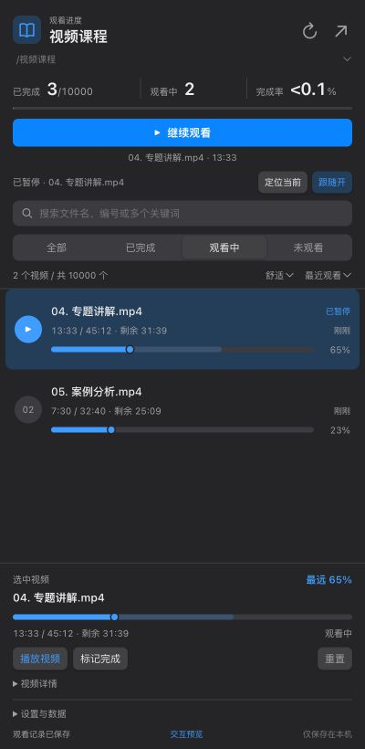

# IINA Watch Progress 使用指南

适用版本：**0.1.3 开发预览版** · 对照环境：**IINA 1.5.1 / macOS** · 更新日期：**2026 年 11 月 25 日**

这个插件用来回答三个问题：这个文件夹看完了多少、每个视频看到哪里、下次从哪个视频继续。安装后仍然在 IINA 中播放视频，通过额外的“观看进度”侧边栏管理记录。

**普通使用无需安装 Node.js、pnpm，也无需运行代码。直接安装已经打好的 `.iinaplgz` 文件即可。**

> 截图说明：图 1 是真实 IINA 设置页面；下面的 0.1.3 实机图和“0.1.1 修正说明”中的图片使用隔离的合成视频。其余功能图是带“交互预览”标识的示例数据。旧版功能图保留用于说明相同操作，新布局以 0.1.3 截图为准。完整多窗口压力、强制崩溃和其他系统版本仍待验收。

## 0.1.3 更新说明

新增「定位当前」「跟随开/关」、多关键词搜索、舒适/紧凑列表、位置与剩余时长、视频详情和可拖动的双层进度条。浏览位置按文件夹记忆；升级沿用原记录，不需要重新导入。

下面是本机 IINA 1.5.1 的实际运行图，两个文件均为无声合成测试视频：



已在实机验证：暂停状态拖动到 1:00 后仍保持暂停并保存；切换视频后定位当前项；侧栏随播放更新；关闭测试播放器再重开后重新挂载并恢复浏览选择。测试前后原有 149 条课程记录完全一致，另两个合成测试记录随播放正常更新。

## 0.1.2 更新说明

列表每行左侧的圆形按钮现在可以直接控制播放：当前视频播放时显示 `Ⅱ`，点击暂停；暂停时显示 `▶`，点击继续。点击其他视频的圆形按钮会播放那个视频。单击文件名仍只选择，双击文件名仍播放。

播放进度每秒更新内存和界面，**不是每秒写入磁盘**。自动保存默认 5 秒，可在底部「设置与数据 → 自动保存间隔」选择 15、30 或 60 秒，详见第 9 节。更新沿用原有记录，不需要清空数据。本机已加载新脚本并验证同一圆形按钮的播放、暂停和暂停后保存；IINA 设置页缓存的旧版本号可能要在正常重启后刷新。



*0.1.2 交互预览截图：1000 个示例视频中筛选出 2 个观看中项目；蓝色圆形按钮显示 `Ⅱ`，表示该视频正在播放。此图不是真实课程记录。*

## 0.1.1 修正说明

本版修复了“正在连接观看记录…”不消失、列表为空的问题：消息改为显式 JSON 编码并在下一轮事件循环回复，同时保留消息回调的强引用。启用已有播放器窗口中的插件时，也会重新附着到当前视频。已有记录和设置沿用原来的数据目录，不需要重新导入。

下面是 0.1.1 在真实 IINA 1.5.1 中使用合成测试视频的截图，不是浏览器预览：



## 目录

- [1. 第一次使用：安装并打开](#1-第一次使用安装并打开)
- [2. 认识界面](#2-认识界面)
- [3. 每天如何观看课程](#3-每天如何观看课程)
- [4. 播放与继续观看的区别](#4-播放与继续观看的区别)
- [5. 搜索、筛选和排序](#5-搜索筛选和排序)
- [6. 手动完成与重置](#6-手动完成与重置)
- [7. 设置自动完成阈值](#7-设置自动完成阈值)
- [8. 独立窗口、主题和快捷操作](#8-独立窗口主题和快捷操作)
- [9. 记录保存与文件夹统计](#9-记录保存与文件夹统计)
- [10. 备份与恢复](#10-备份与恢复)
- [11. 多窗口使用](#11-多窗口使用)
- [12. 常见问题](#12-常见问题)
- [13. 首次安装后的检查](#13-首次安装后的检查)
- [14. 源码构建与浏览器预览](#14-源码构建与浏览器预览)

## 1. 第一次使用：安装并打开

### 第一步：找到安装包

本项目已经生成安装包：

```text
/Users/qiang/Projects/iina-watch-progress/release/iina-watch-progress-0.1.3.iinaplgz
```

在 Finder 中按 **⌘⇧G**（前往文件夹），粘贴下面的目录并回车：

```text
/Users/qiang/Projects/iina-watch-progress/release/
```

选用 `iina-watch-progress-0.1.3.iinaplgz`。旁边可能还有以 `.iinaplugin` 结尾的构建目录，普通安装使用前者。无需先解压安装包。

### 第二步：在 IINA 中安装

1. 打开 IINA。
2. 按 **⌘,** 打开设置，在左侧选择 **插件**。
3. 点击页面顶部的 **安装本地插件…**。
4. 在文件选择器中选择上一步的 `.iinaplgz` 文件。
5. 阅读 IINA 展示的插件信息和权限提示，然后按界面提示完成安装。本插件请求文件系统访问，用于读取视频目录并保存本地记录，不请求网络权限。
6. 安装后，在插件列表中找到 **IINA Watch Progress**，确认已启用。
7. 在方便中断播放时，正常退出并重新打开 IINA，让播放器窗口加载插件。



*图 1 · 真实 IINA 1.5.1 设置页面。入口是顶部的“安装本地插件…”。这张图截取于安装前，因此列表中还没有 IINA Watch Progress；其他插件无需改动。点击图片可查看原图。*

### 第三步：打开一个视频，再显示观看进度

1. 在 Finder 中找到课程文件夹，用 IINA 打开其中一个本地视频。也可以使用你平时在 IINA 中打开文件夹或播放列表的方式。
2. 在 macOS 菜单栏的 **插件** 菜单中，找到本插件的 **显示观看进度**。
3. 侧边栏会显示当前文件夹名称、统计数据和视频列表。

插件菜单依赖播放器窗口，第一次安装后请先打开一个视频。不要只停留在 IINA 的欢迎界面查找菜单。

即使 IINA 当前只打开了一个视频，插件也会尝试列出**同一目录下的其他视频**。不需要逐个添加到 IINA 的播放列表。

**没有出现界面时：**先确认插件已启用，正常重启 IINA，再重新打开一个支持的视频文件，最后点击“显示观看进度”。更多排查见第 12 节。

## 2. 认识界面



*图 2 · 0.1.3 浅色界面预览。1000 条示例记录中筛选出 2 个观看中项目。第 4 项最后位置约 30%，浅色历史进度保留在 65%。*

| 区域 | 显示什么 | 可以做什么 |
| --- | --- | --- |
| 顶部文件夹名称与路径 | 当前管理的文件夹 | 当前播放列表涉及多个文件夹时，可在路径下拉框中切换 |
| 右上角 `↻` | 刷新按钮 | 添加、移除文件或重新连接磁盘后，重新读取文件夹 |
| 右上角 `↗` | 独立窗口按钮 | 将观看列表显示在一个单独窗口中 |
| 已完成、观看中、完成率 | 整个当前文件夹的统计 | 查看课程整体进展；不随搜索和筛选改变 |
| 蓝色“继续观看”按钮 | 最近观看的未完成视频 | 点击后恢复该视频在插件中保存的位置；下方小字显示目标视频和时间 |
| 当前视频与定位工具栏 | 正在播放/已暂停的文件、跟随状态 | 一键定位；打开或关闭切换视频时的跟随 |
| 搜索框 | 文件名关键词 | 快速缩小列表范围 |
| 全部 / 已完成 / 观看中 / 未观看 | 状态筛选 | 只查看某一种观看状态 |
| 列表右上角排序菜单 | 文件名 / 观看进度 / 最近观看 | 改变插件列表的显示顺序 |
| 舒适 / 紧凑 | 列表密度 | 查看更丰富信息，或在同一窗口显示更多行 |
| 视频列表 | 文件名、时长、进度、状态 | 单击文件名选择；双击文件名播放；左侧圆形按钮播放/暂停 |
| 底部“选中视频” | 当前选中的文件及其记录 | 播放、标记完成、重置；展开视频详情；调整当前视频的位置 |
| 设置与数据 | 完成阈值、保存间隔和数据入口 | 修改设置；在 Finder 中定位记录 |
| 最底部保存提示 | 保存状态 | 确认记录是否已经落盘 |

**单击文件名选中与正在播放是两回事。**浅蓝色背景表示选中项，左侧蓝色圆形按钮表示当前播放项。选中其他视频后，底部操作针对选中项，当前视频不会因此切换；点击左侧圆形按钮会控制播放。

绿色对勾表示已完成。列表中显示的时长为 `—` 时，通常只是该视频尚未被播放，插件还不知道它的时长。

## 3. 每天如何观看课程

### 第一次学习

1. 用 IINA 打开课程文件夹内的一个视频。
2. 显示“观看进度”侧边栏。
3. 双击要看的视频，或者选中后点击底部 **播放视频**。
4. 正常播放，插件自动更新观看进度。
5. 暂停或结束观看时，检查底部是否显示 **观看记录已保存**，再正常退出 IINA。

### 快速找到正在播放的视频

1. 点击搜索框上方的 **定位当前**。插件会选中当前视频并滚动到附近，不重新播放或跳转。
2. 若当前视频在其他播放列表文件夹，插件会先切回它的文件夹。
3. 若搜索或状态筛选隐藏了当前视频，界面会提示。点击 **显示当前视频** 才临时切到全部并清空搜索；原筛选保留，点击 **恢复筛选** 即可回到原结果。

**跟随开** 时，切换视频会定位一次；滚轮、触控板、搜索、筛选或方向键浏览会变为 **跟随关**。插件不会每秒把列表拉回当前项。点击「定位当前」或重新开启跟随，可恢复定位。

返回曾经浏览的文件夹时，优先恢复上次选中项、滚动位置、搜索、筛选、排序和密度，因此可能先停留在正在播放的视频之外。这时点击定位即可。

如果整个文件夹都还没有观看记录，顶部按钮会显示 **开始观看**，从自然文件名顺序的第一个未完成视频开始。

### 第二天继续

1. 重新用 IINA 打开原文件夹中的一个视频。
2. 显示“观看进度”，确认顶部文件夹正确。
3. 查看蓝色按钮下面的小字，确认将要继续的视频和位置。
4. 点击 **继续观看**。

例如，按钮下方可能显示：

```text
04. 专题讲解.mp4 · 29:22
```

这表示点击按钮后会选择这个视频，并尝试跳转到插件保存的 29 分 22 秒。

“继续观看”会在**当前文件夹中**寻找最近实际播放过、尚未完成的视频。没有已观看的未完成视频时，选择文件名顺序最靠前的未完成项；所有视频都完成时，按钮显示 **全部已看完** 并禁用。

**本版没有课程库首页或历史文件夹列表。**每次仍需要你先在 IINA 中打开目标文件夹内的视频。搜索、筛选不会改变“继续观看”的文件夹范围；点击前以下方提示的目标为准。

## 4. 播放与继续观看的区别

| 操作 | 选择哪个视频 | 从哪里开始 |
| --- | --- | --- |
| 单击列表项 | 仅选中，不开始播放 | 不改变当前播放位置 |
| 点击当前视频的圆形按钮，或在列表中选中它后按空格 | 当前视频播放/暂停切换 | 保持当前位置，不重新加载或跳转 |
| 点击其他视频的圆形按钮 | 播放那个视频 | 交给 IINA 原生断点续播决定 |
| 双击列表项 | 双击的那个视频 | 交给 IINA 原生断点续播决定 |
| 选中后按回车，或点击“播放视频” | 选中的视频 | 交给 IINA 原生断点续播决定 |
| 点击顶部“继续观看” | 当前文件夹最近观看的未完成视频 | 明确跳转到本插件保存的最后位置 |

如果想**回到插件保存的位置**，使用“继续观看”。如果想**自己选择某一节**，双击对应视频即可。

本版没有“继续所选视频”按钮。顶部“继续观看”的目标与底部选中项可以不同。对已经正在播放的视频点击“播放视频”，会解除暂停，不会强制从头重播。

### 进度条与最后位置也不完全相同

插件进度使用**历史最远播放位置**，续播使用**最后一次位置**。

0.1.3 的浅色条表示历史最远进度，已完成项表示完成标记；实色条和圆点表示最后位置。回退播放后，圆点会向左移动，历史进度仍保留。已完成后重播也不会撤销完成状态。

### 如何拖动进度

1. 先播放需要调整的视频，等到时长显示。
2. 拖动该行的进度条，或底部「选中视频」的进度条。拖动时只在界面预览时间，松手后才发送跳转。
3. 暂停时拖动后仍暂停；播放时拖动后继续播放。悬停在可调整的进度条上可查看对应时间。

未播放项和未知时长项的进度条不能调整，避免误操作打开其他文件。直接拖到 95% 仍可能触发默认完成条件；进度条不代表实际观看覆盖率。

例如：一个 100 分钟的视频，你先播放到 60 分钟，后来回退到 20 分钟。

- 进度条仍是 60%，说明你曾经到达过那里。
- 继续观看的位置可能是 20 分钟，因为那是最后停留的位置。

已完成视频的显示进度固定为 100%，但不把最后播放位置强制写成片尾。所以手动完成后，底部仍可能显示 `29:22 / 45:12`，这属于正常情况。

## 5. 搜索、筛选和排序

搜索支持空格分开的多个关键词，顺序不限。例如输入 `058 德国`，只显示文件名同时包含这两个词的视频；输入编号也可定位课程。全角数字和英文字母会做兼容匹配。

### 密度与视频详情

列表右上角可选择 **舒适**（88 px 行高，显示最近观看）或 **紧凑**（68 px 行高，隐藏行内最近观看，保留位置和剩余时间）。切换密度时尽量保持当前浏览的文件不跳动。

底部展开 **视频详情**，可查看分辨率、视频编码、实际观看时间、播放次数、最近观看及完整路径，也可在 Finder 中显示文件。分辨率和编码在实际打开该视频后获取；插件不会为补齐信息批量读取所有视频，当前界面最多缓存 100 个视频的参数。

### 按观看状态筛选

点击 **观看中**，只显示已开始但未完成的视频：



*图 3 · “2 个视频 / 共 8 个”是筛选后的数量；顶部“3/8”和“37.5%”仍是整个文件夹的完成统计。*

三种状态的含义：

| 状态 | 进入条件 |
| --- | --- |
| 未观看 | 新发现的视频，或已手动重置的视频；刚打开、累计实际播放不足 5 秒时也可能保持此状态 |
| 观看中 | 累计实际播放达到 5 秒，且尚未完成 |
| 已完成 | 历史最远位置达到设定阈值、确认正常到达片尾，或者手动标记完成 |

重新播放已经完成的视频，**不会自动清除完成状态**。

### 搜索文件名

在搜索框输入文件名的一部分，例如“理论”“第 3 章”或“案例”。搜索与状态筛选同时生效。

搜索不到时，先清空关键词并切回 **全部**。关键词只匹配文件名，不搜索字幕、课程内容或文件路径。

### 排序

列表右上角的菜单提供：

- **文件名：**按自然顺序排列，例如 2 在 10 前面，适合按章节观看。
- **观看进度：**进度高的在前。
- **最近观看：**最近实际播放过的在前。

这里的排序只改变插件列表的显示顺序，**不会重排 IINA 原生播放列表，也不会改变 IINA 播放下一项的顺序**。

## 6. 手动完成与重置

### 手动标记完成

适合已经在其他播放器看完、无需重复播放的视频。

1. 单击目标视频，核对底部“选中视频”的文件名。
2. 点击 **标记完成**。
3. 该视频显示为已完成，顶部完成数量和完成率随之变化。



*图 4 · 操作后完成率从 37.5% 变成 50%。当前筛选是“观看中”，所以刚标记完成的视频退出筛选列表，但底部仍保留它的选中详情。*

如果“标记完成”按钮变灰，可能是该项已经完成，或者存储进入只读状态。查看底部状态和页面提示即可区分。

### 重置为未观看

1. 单击要重新记录的视频，核对底部文件名。
2. 点击 **重置**。
3. 状态变为未观看，进度和最后位置归零。



*图 5 · 该视频从已完成变成未观看，文件夹完成数也恢复为 3/8。*

重置会清除这条记录的最后位置、最远位置、累计观看时长、播放次数及观看时间信息，保留文件身份和已知视频时长。原视频文件不会变化。本版没有撤销按钮。

如果这个视频正在播放，插件会让**同一个 IINA 进程内播放该文件的所有窗口暂停，并跳到开头**，防止旧的高进度采样马上把它标为完成。准备好重新观看时，再点击播放。

重置仅影响本插件的记录，不等于删除 IINA 自己的播放历史；普通重新打开文件时，原生断点续播仍可能生效。

## 7. 设置自动完成阈值

1. 展开底部 **设置与数据**。
2. 在 **自动完成阈值** 中选择数值。
3. 选择后自动保存，不需要额外点击“保存”。



*图 6 · 当前可选值为 80%、85%、90%、95%、100%，默认 95%。*

例如，视频时长为 40 分钟，阈值为 95%，到达第 38 分钟就可以自动标记完成。这适合片尾有字幕、致谢或空白画面的资源。

该设置对本插件管理的视频统一生效，不是每个文件夹单独设置。调整阈值只影响后续自动判断，不会撤销已经完成的视频；降低阈值后，未完成视频可能在后续播放采样时达到新的完成条件。

**阈值根据到达的位置判断，不代表实际看过相同比例。**直接拖到 95% 也可能完成。若更看重到达片尾，可以选择 100%；具体 EOF 行为仍需在真实 IINA 环境验证。

## 8. 独立窗口、主题和快捷操作

### 独立观看列表

点击侧边栏右上角 **`↗`**，或使用“插件”菜单中的 **独立观看列表**。

它与侧边栏提供相同的列表和操作，适合把课程进度放在另一个显示器。这个窗口关联发起它的播放器窗口，不是跨所有播放器窗口的课程库。关闭关联播放器窗口时，独立窗口也会关闭。

### 深色与浅色外观

界面根据系统提供给 WebView 的深浅色外观自动适配，插件内没有独立的主题切换开关。



*图 7 · 万条示例记录中的观看中筛选，功能与浅色界面相同。完成率很小时显示 `<0.1%`，总数仍准确显示。*

### 常用操作速查

| 操作 | 方法 |
| --- | --- |
| 选中视频 | 单击一行 |
| 播放视频 | 双击一行，或选中后点击“播放视频” |
| 播放/暂停 | 点击行左侧圆形按钮；选中项为当前视频时切换暂停，其他视频则开始播放 |
| 键盘选择 | 先让视频列表获得焦点，再按 `↑` / `↓` |
| 播放选中项 | 列表获得焦点时按 `Enter` |
| 播放/暂停选中项 | 列表获得焦点时按空格；其他视频会开始播放 |
| 定位正在播放的视频 | 点击搜索框上方「定位当前」 |
| 调整播放位置 | 拖动当前视频或底部进度条，松手跳转；聚焦底部进度条后也可使用方向键 |
| 显示更多行 | 列表密度选择「紧凑」 |
| 选择首项或末项 | 列表获得焦点时按 `Home` / `End`；没有独立按键的 Mac 键盘可尝试 `Fn + ←` / `Fn + →` |
| 刷新目录 | 点击右上角 `↻` |
| 打开独立窗口 | 点击右上角 `↗` |

这些按键作用于插件的视频列表。输入框正在输入时，应先离开输入框；播放器自身快捷键仍由 IINA 管理。

## 9. 记录保存与文件夹统计

### 保存时机

| 情况 | 保存方式 |
| --- | --- |
| 正常播放 | 有记录变化时按自动保存间隔写入，默认约每 5 秒 |
| 暂停 | 立即尝试保存 |
| 切换、结束视频 | 立即尝试保存 |
| 手动完成、重置、修改阈值或保存间隔 | 立即尝试保存 |
| 正常关闭播放器窗口 | 尽可能保存最后记录 |

查看界面最底部提示：

| 提示 | 含义与处理 |
| --- | --- |
| 观看记录已保存 | 最近一次记录已通过写入后校验 |
| 等待保存… | 有新变化，等待下一次保存；正常播放时短暂出现是正常的 |
| 尚无观看记录 | 暂时没有成功保存的记录 |
| 记录未保存 | 查看上方具体错误；检查磁盘空间和写入权限 |
| 记录只读 | 插件为保留现有文件停止写入；按第 10、12 节处理 |

强制结束进程、断电等异常退出，可能丢失最近约一个保存周期的变化；默认约 5 秒，若选择 30 秒则可能约 30 秒。若最新快照损坏，恢复的备用快照还可能早一个周期；持续写盘失败期间的内存变化不能保证恢复。

### 如何减少磁盘写入

1. 展开底部 **设置与数据**。
2. 在 **自动保存间隔** 选择 5、15、30 或 60 秒。设置立即生效并保存；旧版本记录自动使用默认 5 秒。
3. 在小窗口中，展开后的底部区域可以独立滚动，向下滚动即可找到保存间隔和数据入口。

| 间隔 | 持续有变化时的周期写入次数/小时 | 适用取舍 |
| --- | ---: | --- |
| 5 秒（默认） | 约 720 次 | 尽量保留最近进度 |
| 15 秒 | 约 240 次 | 减少约 2/3 的周期写入 |
| 30 秒 | 约 120 次 | 减少约 5/6 的周期写入 |
| 60 秒 | 约 60 次 | 写入更少，但异常退出可能丢失更长的最近进度 |

以上不含暂停、切换等操作的即时保存。播放位置在内存中按秒更新，界面实时刷新不需要写文件；没有变化不写盘，多窗口共用一个全局保存器。每次只写一个快照文件，两个槽位交替使用，不是同时写两份。当前仍是完整 JSON 快照，每次写入的大小随历史记录数量增加；不会为了记录进度读取或哈希视频内容。测量方法和实现细节见 [性能说明](performance.md)。

### 浏览位置保存

浏览偏好与观看记录分开：最多保存 40 个文件夹的界面状态，以 600 ms 去抖写入 WebView 本地存储，连续滚动不会每一帧写入。存储不可用时保留当前界面会话内记忆。该偏好不是课程库或历史文件夹入口，也不包含在两份观看记录快照的备份里。

### 文件夹统计范围

统计对象是**当前文件夹下的直接子视频**，包括没有进入 IINA 播放列表的同目录视频。不包含更深的子文件夹，也不把搜索结果当作整个文件夹。

例如：

```text
课程/
├── 01.mp4        ← 计入“课程”
├── 02.mkv        ← 计入“课程”
├── 讲义.pdf      ← 不计入
└── 补充材料/
    └── 03.mp4    ← 不计入“课程”；打开它后管理“补充材料”
```

目录无法读取时，插件会提示 **仅统计当前播放列表**。这时顶部总数可能小于磁盘中的实际数量，不能视为整个文件夹的统计。

本版识别 `mp4、m4v、mkv、mov、avi、webm、flv、wmv、mpg、mpeg、ts、mts、m2ts、vob、ogv、3gp` 扩展名，不区分扩展名大小写。音频、网络播放地址和虚拟光盘路径不在当前范围内。

## 10. 备份与恢复

### 找到记录目录

在插件底部展开 **设置与数据**，点击 **在 Finder 中显示记录**。当前 IINA 的通常位置为：

```text
~/Library/Application Support/com.colliderli.iina/plugins/.data/io.iina.watch-progress/
```

也可以在 Finder 中按 **⌘⇧G**，粘贴上面的路径。`~` 表示当前 macOS 用户的个人目录。

目录内主要有两个文件：

```text
records.json
records.backup.json
```

它们是交替使用的两个快照。**不能根据文件名判断哪个更新，也不要只备份其中一个。**插件会选取校验通过、内部版本序号较高的那一份读取；设置也在快照中。

### 手动备份

1. 先用“在 Finder 中显示记录”找到目录。
2. 正常退出 IINA，确保所有播放器窗口都已退出。
3. 将整个 `io.iina.watch-progress` 数据目录复制到你选定的备份位置，例如 `IINA观看记录备份-2026-11-25`。
4. 保留目录内的两个 JSON 文件。

本版尚无“导出”“导入”按钮，备份通过 Finder 复制完成。

### 从自己的备份恢复

1. 正常退出 IINA。
2. 先把当前数据目录另行复制一份留存。
3. 将同一备份中的两个快照复制回插件数据目录，替换对应文件。不要与其他时间的单个快照混搭。
4. 重新打开 IINA 和相同路径的视频，检查历史状态。

恢复备份会回到备份时的记录。视频本身不包含在观看记录备份中，需要仍在原来的路径。

### 遇到损坏或新版本记录

- **一份快照损坏：**插件尝试读取另一份有效快照，界面会提示已从有效快照恢复，部分最近进度可能较早。
- **现存快照均无法读取：**插件保留原文件并停止写入。先复制整个数据目录，再检查权限、磁盘问题和可用备份。
- **记录来自更新版本：**使用能够读取该格式的更新插件。不要用旧版本强行覆盖。

JSON 有校验字段，不适合直接在文本编辑器里改进度。修改后可能被判为损坏。

## 11. 多窗口使用

同一个 IINA 进程内，可以同时打开多个播放器窗口；插件使用全局实例统一管理记录，减少不同窗口互相覆盖的问题。

需要区分两种情况：

- **不同窗口播放不同视频：**分别更新各视频的记录。
- **不同窗口播放同一个视频：**完成状态保持；最后位置以最后收到的采样为准；各窗口的观看时间会相加。

如果对同一个正在播放的视频执行重置，相关窗口都会暂停归零。这是统一清除该文件记录的结果。

同时运行多个独立 IINA 进程并共用同一数据目录，不在本版支持范围。多窗口行为目前已通过模拟测试，真实播放器场景仍待验收。

## 12. 常见问题

### 已安装，但找不到“显示观看进度”

确认安装的是 `.iinaplgz`，在设置的插件列表中已启用，然后正常重启 IINA，打开一个本地视频，再到菜单栏“插件”中查找本插件的菜单。

本指南的设置截图对应 IINA 1.5.1。如果版本或语言不同，文字和布局可能不同；先确认版本具有插件功能。

### IINA 原生播放列表里为什么没有对勾？

本插件通过**自定义侧边栏**展示状态，不修改原生播放列表每一行的外观。请使用“显示观看进度”打开插件面板。

### 为什么列表为空或数量不对？

先打开一个受支持的本地视频，清空搜索、切回“全部”，再点击刷新。检查资源是否在子文件夹、外接磁盘是否在线，以及有没有文件夹读取失败提示。

### 为什么“观看中”筛选只有 2 项，顶部却仍显示 8 项？

列表数量是筛选结果，顶部总数与完成率始终对应当前文件夹。图 3 就是这个情况。

### 为什么刚打开视频，仍显示“未观看”？

进入观看中需要累计实际播放达到 5 秒。只加载、暂停或拖动位置，不一定累计实际观看时间；到达完成阈值则可能直接变成已完成。

### 为什么把进度条拖到末尾，也会标记完成？

当前采用播放位置阈值，不是观看区间覆盖率。尚不能判断拖过去的部分是否真正看过。

### 为什么重新看一遍，还是“已完成”？

完成状态会保留。要重新从零记录，请选中该视频并点击“重置”。

### 为什么点击“继续观看”，播放的不是我刚选中的视频？

它选择的是当前文件夹最近观看的未完成视频，不是列表选中项。点击前看按钮下面的文件名；要播放指定视频，请双击它。

### 为什么时长显示“—”？

尚未播放的视频通常没有时长信息。插件不会为显示时长逐个打开全部文件；开始播放后会更新已知时长。

### 移动或重命名视频后，为什么记录不见了？

本版按标准化完整路径识别。改文件名、移动文件夹、改变外接磁盘挂载路径或通过另一条符号链接路径打开，都可能被当成新文件。把文件放回原路径可再次匹配原记录；自动迁移识别尚未实现。

### 已经用 IINA 看过的课程，会自动导入吗？

不会。本版没有导入 IINA 原生历史的功能。安装前已看完的内容，可以逐项手动标记完成。

### 状态一直显示“正在连接观看记录…”怎么办？

0.1.0 存在跨实例消息回传问题，会出现记录已保存但界面仍为空。请升级到 0.1.3，正常重启 IINA，再重新打开视频。0.1.3 也处理了 IINA 1.5.1 侧栏可见性空值，以及关闭后重用播放器窗口时的重新挂载。若仍异常，记录插件版本、IINA 版本和页面提示，在 IINA 日志查看器检查本插件加载错误。不要先删除记录目录。

### 显示“记录未保存”或“记录只读”怎么办？

查看上方错误。保存失败时，检查可用磁盘空间和记录目录权限，插件会自动重试。只读时，按第 10 节先备份，再处理损坏或版本兼容问题。

### 更新、停用或卸载前要做什么？

先暂停并确认记录保存，再正常退出 IINA，按第 10 节备份。停用或卸载可在 IINA 设置的插件页面操作；当前尚未验证 IINA 卸载时是否保留数据目录，所以不要把它当成备份方式。移除插件不会修改原视频文件。

## 13. 首次安装后的检查

建议先使用一个独立测试文件夹验证本机环境，再依赖它管理长期课程。可以使用几段不重要的视频副本。

1. **发现目录：**打开其中一个视频，侧边栏应列出同目录下受支持的视频。
2. **记录进度：**播放超过 5 秒，暂停，确认底部显示已保存。
3. **跨重启：**正常退出并重开 IINA，再打开同一文件夹，检查历史状态和进度。
4. **继续观看：**点击顶部按钮，检查目标视频和保存位置。
5. **手动操作：**对一个测试视频标记完成，检查计数；再重置，检查归零。

若结果与指南不同，反馈时提供 **IINA 版本、插件版本、具体操作、预期结果和实际提示**。截图中如有私人路径或课程名称，可以先遮盖。

当前已通过 56 项自动化测试、类型检查、构建和打包检查；这些不替代上述真实播放器验收。详细记录见 [验收记录](acceptance.md)。

## 14. 源码构建与浏览器预览

普通安装可以跳过本节。以下命令在本项目目录执行，需要 Node.js 22、pnpm 10 和已安装的 IINA。

### 重新构建安装包

```sh
cd /Users/qiang/Projects/iina-watch-progress
pnpm install
pnpm check
pnpm run package
```

安装包输出到 `release/`。请用 **`pnpm run package`**；`pnpm pack` 是 pnpm 自带的 npm 归档命令，不会生成 IINA 安装包。

### 只体验界面

```sh
cd /Users/qiang/Projects/iina-watch-progress
pnpm build
pnpm preview
```

在浏览器打开 [本地交互预览](http://127.0.0.1:4173)。预览只模拟界面交互，不控制播放器，不保存真实观看记录；关闭预览后数据会重置。在终端按 `Ctrl+C` 停止服务。

| 预览地址 | 用途 |
| --- | --- |
| [默认预览](http://127.0.0.1:4173) | 8 个示例视频 |
| [深色外观](http://127.0.0.1:4173/?appearance=dark) | 查看深色界面 |
| [浅色外观](http://127.0.0.1:4173/?appearance=light) | 查看浅色界面 |
| [1000 项列表](http://127.0.0.1:4173/?count=1000) | 检查长列表操作 |
| [空列表](http://127.0.0.1:4173/?empty) | 查看没有视频时的状态 |

### 文档与截图

- [项目说明与开发方式](../README.md)
- [验收记录](acceptance.md)
- [截图来源说明](screenshots/README.md)
- [IINA 官方插件创建与安装说明](https://docs.iina.io/pages/creating-plugins.html)

本指南描述的是 0.1.3 已有界面和实现；保留的早期截图用于说明原有功能，新布局以 0.1.3 截图和文字为准。课程库、子目录递归扫描、移动文件后恢复身份、观看覆盖率、批量操作、自动跳过完成项及备份导入导出界面，尚未提供。存储分片和追加日志留待独立版本验证，本版继续使用兼容的双快照 JSON。
